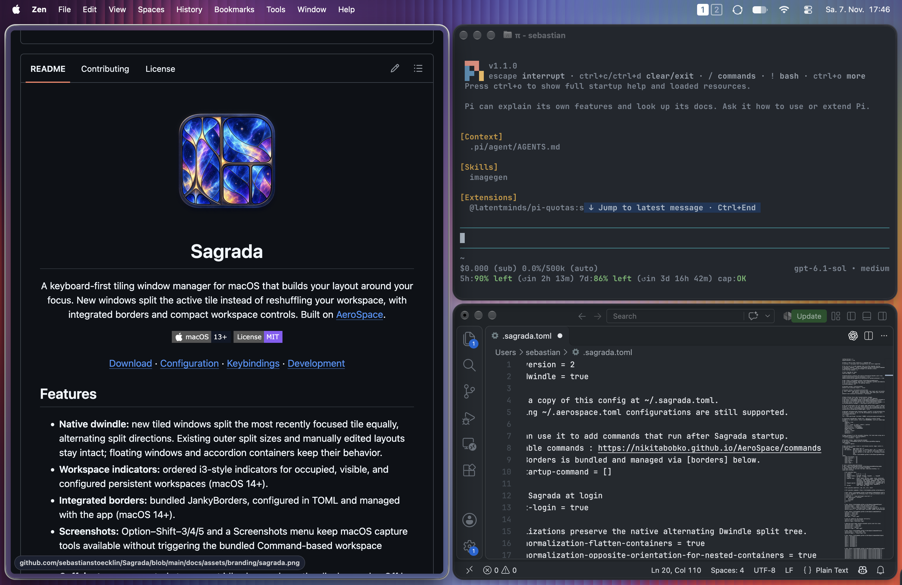

<div align="center">


# Sagrada

A keyboard-first tiling window manager for macOS that builds your layout around your focus.
New windows split the active tile instead of reshuffling your workspace, with integrated borders and compact workspace controls.
Built on [AeroSpace](https://github.com/nikitabobko/AeroSpace).


[](LICENSE.txt)

[Download](https://github.com/sebastianstoecklin/Sagrada/releases/latest) · [Configuration](#configuration) · [Keybindings](#keybindings) · [Development](dev-docs/development.md)

</div>



## Features

- **Native dwindle:** new tiled windows split the most recently focused tile equally, alternating split directions. Existing outer split sizes and manually edited layouts stay intact; floating windows and accordion containers keep their behavior.
- **Workspace indicators:** ordered i3-style indicators for occupied, visible, and configured persistent workspaces (macOS 14+).
- **Integrated borders:** bundled JankyBorders, configured in TOML and managed with the app (macOS 14+).
- **Screenshots:** Option–Shift–3/4/5 and a Screenshots menu keep macOS capture tools available without triggering the bundled Command-based workspace shortcuts.
- **Keep awake:** menu controls to prevent idle sleep or keep the display awake. Off by default; quitting releases the sleep assertions.
- **Reverse scrolling:** optional mouse-wheel reversal with independent axis controls and continuous gesture passthrough.
- **AeroSpace controls:** virtual workspaces, multiple displays, a scriptable CLI, and plain-text configuration without disabling SIP.

This is a personal fork, not an official AeroSpace release.

## Install

Requires **macOS 13+** on **Apple Silicon or Intel**. No Xcode is needed for the download.

1. Download and extract the ZIP from [GitHub Releases](https://github.com/sebastianstoecklin/Sagrada/releases/latest). Release notes and checksums are available there.
2. Quit any other tiling window manager.
3. Drag **Sagrada.app** into **Applications**, then open it.
4. Grant access in **System Settings → Privacy & Security → Accessibility**.

> [!NOTE]
> The app is not notarized by Apple. If macOS blocks it and you trust the download, try opening it, then choose **System Settings → Privacy & Security → Open Anyway**. Do not disable Gatekeeper.

**Update:** quit Sagrada, replace the app with the new download, and reopen it. Your configuration is not overwritten. This fork does not receive upstream Homebrew updates.

**Uninstall:** disable `start-at-login` in your config, reload, and quit. Move the app to the Trash and remove any remaining login item in System Settings. Keep or remove your configuration and helper state as desired.

## New in 0.4.5

- The dropdown header now shows **Sagrada + version**, with shorter menu and submenu entries.
- **Keep awake** offers Off, System, and System & display; **Reverse scrolling** offers independent axis controls.
- A desktop screenshot now showcases the tiled layout, borders, and workspace indicators above.

No configuration migration is required. See the [0.4.5 release notes](docs/release-notes/0.4.5.md). The app is ad-hoc signed; macOS may require renewed Accessibility approval after updating.

## Configuration

Use `~/.sagrada.toml` or `$XDG_CONFIG_HOME/sagrada/sagrada.toml`, then choose **Config → Reload** from the menu. See the [bundled config](docs/config-examples/default-config.toml) and [upstream guide](https://nikitabobko.github.io/AeroSpace/guide) for the full settings.

Top-level options belong before any `[table]` headers:

```toml
start-at-login = true
# Enabled by default; set false to restore upstream sibling insertion.
enable-dwindle = true
```

### Bundled setup

The bundled config is deliberately personal: Cmd-based navigation, app launch shortcuts, 10-point gaps, workspace 5 on the secondary display, and integrated borders. **Review it before copying**: shortcuts can override familiar macOS and app actions, and launchers require the corresponding apps.

From a source checkout:

```sh
if [ -f "$HOME/.sagrada.toml" ]; then
    cp "$HOME/.sagrada.toml" "$HOME/.sagrada.toml.backup-$(date +%Y%m%d-%H%M%S)"
fi
mkdir -p "$HOME/.config/aerospace"
cp script/workspace-layout.sh "$HOME/.config/aerospace/"
cp docs/config-examples/default-config.toml "$HOME/.sagrada.toml"
```

The [workspace-layout helper](script/workspace-layout.sh) needs this fork’s `sagrada` CLI on `PATH` and stores state in `~/.local/state/aerospace/workspace-layout`. Remove its callback and shortcut if you do not use workspace-wide floating. Reload the configuration after changes.

### Screenshots

While Sagrada runs, screenshot shortcuts move to **Option–Shift–3** (entire screen), **Option–Shift–4** (selection/window), and **Option–Shift–5** (screenshot and recording controls). The **Screenshots** menu offers the same actions without memorizing shortcuts. Captures use macOS's configured destination.

This frees Command–Shift–3/4/5 for moving windows without also taking screenshots. Sagrada temporarily disables the corresponding macOS screenshot hotkeys (including the clipboard variants) and restores their previous enabled states on normal quit; it does not edit your saved keyboard preferences. Touch Bar capture is unchanged. Option–Shift–3/4/5 will not type their usual special characters while Sagrada is running.

The temporary override uses a dynamically loaded private macOS API. If unavailable, the menu reports the failure and the original macOS shortcuts remain active. Force-quitting or a crash can skip cleanup; logging out and back in restores the saved system configuration.

### Borders

Configure `[borders]` in TOML; set `enabled = true` to enable. Options include `width` (0–100 whole points), `style` (`round`, `square`, `uniform`), `active-color`, `inactive-color`, `background-color` (`0xAARRGGBB`), `hidpi`, `ax-focus`, and comma-separated app `blacklist`/`whitelist` values. Reload applies changes; disabling borders or quitting stops the helper. Do not run another JankyBorders instance alongside it.

### Reverse scrolling

Disabled by default. Choose **Reverse scrolling → Enabled** in the menu to reverse classic mouse-wheel scrolling without changing macOS’s Natural Scrolling preference. Menu changes last until a config reload or app restart. To persist them:

```toml
[scroll-reverser]
enabled = true
reverse-vertical = true
reverse-horizontal = false
```

Continuous scrolling, gesture phases, and momentum from trackpads and Magic Mouse pass through. This filters discrete events, not physical devices: smooth-scrolling mouse drivers may also pass through. Do not run another scroll-reversal tool at the same time.

If the event tap cannot start, use **Retry** in the submenu. Check Accessibility and, if requested, Input Monitoring in System Settings, then retry or restart. Disabling the feature, turning off both axes, or quitting removes the filter.

## Keybindings

These are the main shortcuts in the [bundled config](docs/config-examples/default-config.toml); your configuration may differ. `⌘` = Cmd, `⌥` = Option, `⇧` = Shift, `⌃` = Control.

| Shortcut | Action |
| :--- | :--- |
| `⌘` + arrow | Focus a window |
| `⌘ ⇧` + arrow | Swap with a neighboring tile, preserving splits and sizes |
| `⌘` + `1`–`9` | Switch workspace |
| `⌘ ⇧` + `1`–`9` | Move a window to a workspace and follow it |
| `⌥ Tab` | Return to the previous workspace |
| `⌥ ⇧ Tab` | Move the workspace to the next monitor |
| `⌘ ⌥ -` / `⌘ ⇧ =` | Shrink / grow a tile |
| `⌘ ⇧ -` | Select tiles layout; cycle orientation |
| `⌘ ⇧ ,` | Select accordion layout; cycle orientation |
| `⌘ ⌥ F` | Toggle floating for the focused window |
| `⌘ ⌥ ⇧ F` | Toggle floating for the workspace (requires helper) |
| `⌘ ⌃ ←` / `⌘ ⌃ →` | Join with the nearest node on that side |
| `⌘ ⇧ ;` | Enter service mode |

In service mode, `Esc` reloads config, `R` flattens the tree, `F` toggles floating, and `Backspace` closes all other windows. These return to main mode. See the config for launchers, join commands, and volume controls. `⌘ Backspace` is deliberately unbound to preserve Finder’s Move to Trash shortcut.

Swapping preserves the layout; AeroSpace’s `move` command instead edits the tree. Existing configs can adopt this behavior by changing `cmd-shift-<arrow>` bindings from `move <direction>` to `swap <direction>` and adding `--focus-follows-window` to numbered `move-node-to-workspace` bindings.

## Build from source

Install full Xcode, accept its license, and follow the [build prerequisites](dev-docs/development.md#1-install-dependencies), including docs and shell-completion dependencies. The Swift toolchain is specified in [`.swift-version`](.swift-version).

```sh
git clone https://github.com/sebastianstoecklin/Sagrada.git
cd Sagrada
./build-release.sh --codesign-identity -
open .release
```

Copy **Sagrada.app** to Applications. This produces an ad-hoc signed local build; no Apple Developer membership is required.

For development and testing, see [development notes](dev-docs/development.md), [architecture](dev-docs/architecture.md), and [contributing](CONTRIBUTING.md). Artwork regeneration is documented in the [branding notes](docs/assets/branding/README.md).

## Credits and license

Thanks to **[Nikita Bobko](https://github.com/nikitabobko) and the AeroSpace contributors** for the underlying window manager, workspace model, CLI, and documentation.

- [Upstream guide](https://nikitabobko.github.io/AeroSpace/guide) · [Command reference](https://nikitabobko.github.io/AeroSpace/commands) · [Sponsor upstream](https://github.com/sponsors/nikitabobko)
- Report fork-specific problems [here](https://github.com/sebastianstoecklin/Sagrada/issues). Only report upstream after reproducing on an upstream build.

Sagrada is [MIT-licensed](LICENSE.txt); original notices are retained in [legal/](legal). The separately bundled [JankyBorders](https://github.com/FelixKratz/JankyBorders) helper is [GPLv3-licensed](vendor/JankyBorders/LICENSE). Its corresponding source and build script are included under `source/` in release ZIPs and in [vendor/JankyBorders/](vendor/JankyBorders/).
